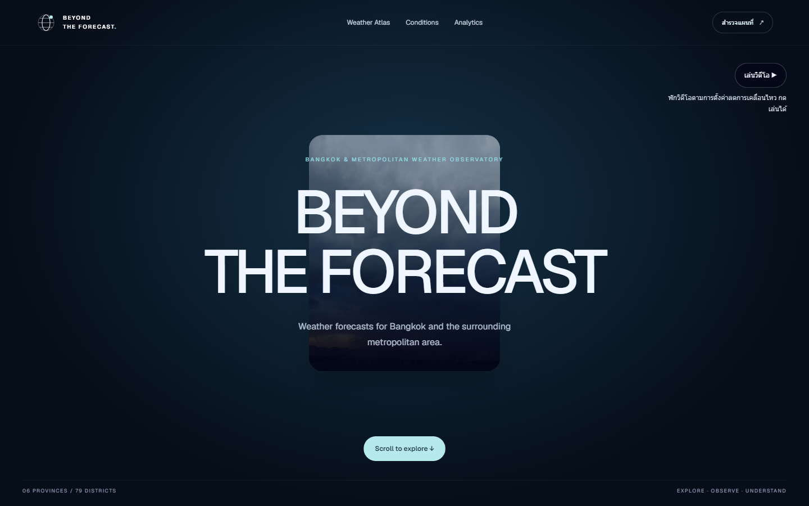

### world in motion
[visit ↗](https://worldinmotion.vercel.app/) &nbsp; · &nbsp; [code](https://github.com/kungnawanghin/world-in-motion)

 

### beyond the forecast
[visit ↗](https://weather-analytics-platform.vercel.app/) &nbsp; · &nbsp; [code](https://github.com/kungnawanghin/weather-analytics-platform)

 

### ict gpa tracker
[visit ↗](https://ict-gpa-tracker-v5l3.vercel.app/) &nbsp; · &nbsp; [code](https://github.com/kungnawanghin/ict-gpa-tracker)

 

 

[Bomberman](https://github.com/abozanona/pacman-contribution-graph)
