<a href="https://github.com/abozanona/pacman-contribution-graph">Bomberman ↗</a>

 

### SELECTED WORK
<samp>interactive worlds · useful tools · things I've built</samp>

 

### WORLD IN MOTION
Explore a 3D globe through population, economy, health and internet access data.

<samp>REACT / TYPESCRIPT / WEBGL / WORLD BANK</samp>

**[Open website ↗](https://worldinmotion.vercel.app/)** &nbsp; · &nbsp; [Source code](https://github.com/kungnawanghin/world-in-motion)

 

---

### BEYOND THE FORECAST
Weather maps, forecasts and historical analytics for Bangkok and surrounding provinces.

<samp>NEXT.JS / TYPESCRIPT / SUPABASE / DATA VISUALIZATION</samp>

**[Open website ↗](https://weather-analytics-platform.vercel.app/)** &nbsp; · &nbsp; [Source code](https://github.com/kungnawanghin/weather-analytics-platform)

 

---

### ICT GPA TRACKER
Record grades, calculate semester and cumulative GPA, and follow your progress.

<samp>NEXT.JS / REACT / TYPESCRIPT / SUPABASE</samp>

**[Open website ↗](https://ict-gpa-tracker-v5l3.vercel.app/)** &nbsp; · &nbsp; [Source code](https://github.com/kungnawanghin/ict-gpa-tracker)

 

---

<samp>TYPESCRIPT &nbsp; · &nbsp; REACT &nbsp; · &nbsp; NEXT.JS &nbsp; · &nbsp; WEBGL &nbsp; · &nbsp; SUPABASE</samp>

<a href="https://github.com/kungnawanghin?tab=repositories">More projects ↗</a>

Layout inspired by <a href="https://github.com/innng/innng">innng</a> · character GIF from their public assets.

