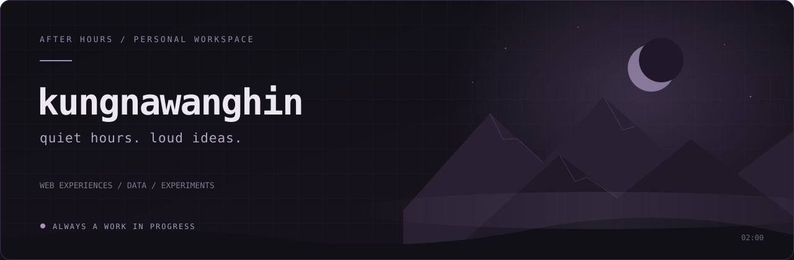

<p align="center">
  
</p>

<p align="center">
  <a href="#01--about">ABOUT</a> &nbsp; / &nbsp;
  <a href="#02--selected-work">SELECTED WORK</a> &nbsp; / &nbsp;
  <a href="#03--toolbox">TOOLBOX</a> &nbsp; / &nbsp;
  <a href="#04--after-hours">AFTER HOURS</a>
</p>

<br>

### `01 / ABOUT`

I build web experiences that make data easier to explore — from a world in motion to the weather closer to home.

```text
kungnawanghin@workspace:~$ cat interests.txt

  interactive interfaces
  maps & data visualization
  practical tools for everyday use
```

<br>

### `02 / SELECTED WORK`

| PROJECT | WHAT'S INSIDE | EXPLORE |
| :--- | :--- | :--- |
| **01 — WORLD IN MOTION** | An interactive 3D globe exploring population, economy, health and internet access through World Bank data. | [Live ↗](https://worldinmotion.vercel.app/) · [Code](https://github.com/kungnawanghin/world-in-motion) |
| **02 — BEYOND THE FORECAST** | Weather maps, forecasts and historical analytics for Bangkok and surrounding provinces. | [Live ↗](https://weather-analytics-platform.vercel.app/) · [Code](https://github.com/kungnawanghin/weather-analytics-platform) |
| **03 — ICT GPA TRACKER** | A workspace for recording grades, calculating semester and cumulative GPA, and tracking progress. | [Live ↗](https://ict-gpa-tracker-v5l3.vercel.app/) · [Code](https://github.com/kungnawanghin/ict-gpa-tracker) |

<br>

### `03 / TOOLBOX`

<p>
  
  
  
  
  
  
  
</p>

<br>

### `04 / AFTER HOURS`

A little chaos after the code. 💣

<picture>
  <source media="(prefers-color-scheme: dark)" srcset="https://raw.githubusercontent.com/kungnawanghin/kungnawanghin/output/bomberman-contribution-graph-dark.svg">
  <source media="(prefers-color-scheme: light)" srcset="https://raw.githubusercontent.com/kungnawanghin/kungnawanghin/output/bomberman-contribution-graph.svg">
  
</picture>

<sub>Animation by <a href="https://github.com/abozanona/pacman-contribution-graph">pacman-contribution-graph</a>.</sub>

<br><br>

---

<p align="center">
  <sub>LESS NOISE. MORE MAKING.</sub><br><br>
  <a href="https://github.com/kungnawanghin?tab=repositories">Browse all projects ↗</a>
</p>
