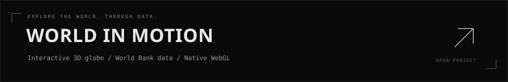
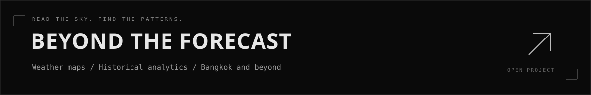
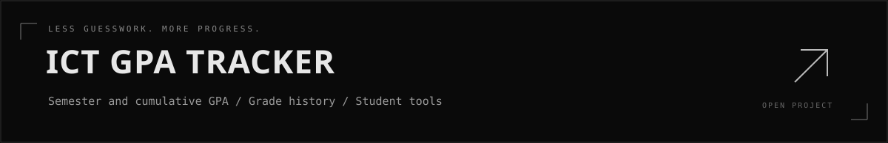
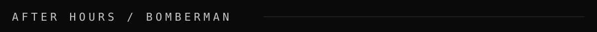

<samp><a href="https://worldinmotion.vercel.app/">LIVE ↗</a> &nbsp; / &nbsp; <a href="https://github.com/kungnawanghin/world-in-motion">SOURCE ↗</a></samp>

<samp><a href="https://weather-analytics-platform.vercel.app/">LIVE ↗</a> &nbsp; / &nbsp; <a href="https://github.com/kungnawanghin/weather-analytics-platform">SOURCE ↗</a></samp>

<samp><a href="https://ict-gpa-tracker-v5l3.vercel.app/">LIVE ↗</a> &nbsp; / &nbsp; <a href="https://github.com/kungnawanghin/ict-gpa-tracker">SOURCE ↗</a></samp>

 

<samp>THE TOOLKIT</samp>

  
  
  
  
  
  
  

  

<a href="https://github.com/abozanona/pacman-contribution-graph">ARCADE ENGINE ↗</a>

 

<samp>END OF TRANSMISSION_</samp>  <samp><a href="https://github.com/kungnawanghin?tab=repositories">ALL REPOSITORIES ↗</a></samp>

